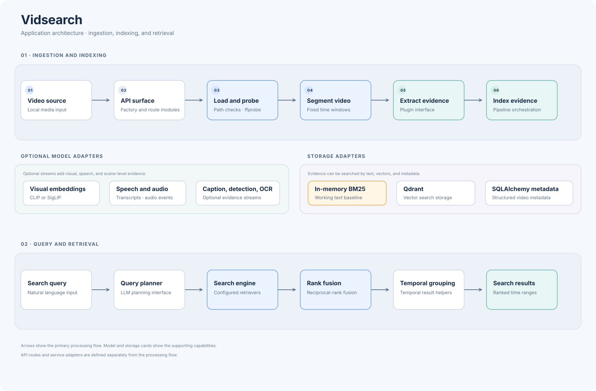
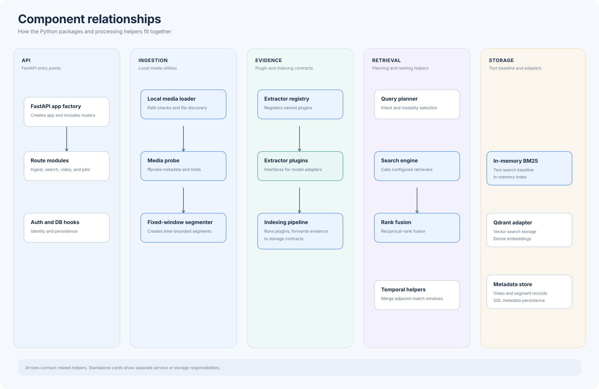

# Architecture

Vidsearch is a Python application scaffold for searching video by visual,
spoken, and other extracted evidence. The diagrams show the intended data
flow and distinguish implemented building blocks from integrations that still
need to be connected.

## Application architecture

The diagram is a visual guide to the processing sequence, not a claim that all
integrations are wired. The FastAPI factory mounts routers, but those routers
currently define no HTTP operations.

### Technology stack summary

| Layer | Technology | Version | Purpose |
|---|---|---|---|
| Application | Python | 3.11+ | Core package and processing interfaces |
| API | FastAPI, Uvicorn | `>=0.110,<1`; `>=0.27,<1` | HTTP application and ASGI server |
| Models and validation | Pydantic | `>=2.6,<3` | Dependency available for future settings and request models |
| Text retrieval | In-memory BM25 implementation | Local baseline | Search over text evidence during development |
| Vector retrieval | Qdrant client | `>=1.9,<2` | Planned dense-vector persistence and search |
| Metadata persistence | SQLAlchemy | `>=2.0,<3` | Planned relational metadata persistence |
| Media processing | FFmpeg/ffprobe, PyAV, OpenCV | System executable; optional package ranges | Probing is implemented; frame and audio decoding are pending |
| Model inference | Transformers, faster-whisper, sentence-transformers | Optional ranges in `pyproject.toml` | Planned visual, speech, and caption extraction |
| Evaluation | Python scripts in `eval/`; PyYAML optional | Local tooling; PyYAML `>=6,<7` | Retrieval-quality and performance measurement |

Versions are constrained in `pyproject.toml`; individual installed versions
depend on the environment. Model adapters and service clients are not yet
connected to the pipeline.

### Data storage and external services

The only working retrieval store in the current scaffold is an in-memory BM25
baseline, which is lost when the process exits. Qdrant and SQLAlchemy are
declared dependencies, but their storage adapters are interfaces/placeholders;
no persistent collection, database schema, or migration setup is currently
wired. Media probing invokes `ffprobe` when explicitly called. Model inference,
remote downloading, and background queue integrations remain unconfigured.

### Key architectural decisions

- Shared `Segment`, `Evidence`, `Query`, and result models provide a common
  contract across ingestion and retrieval.
- Extractors follow a plugin interface so new evidence streams can be added
  without changing the domain schemas.
- Evaluation code is kept separate from application runtime code and consumes
  normalized annotations and ranked prediction exports.

## Component relationships

### Component inventory

The duplicate architecture reference used by modernization tooling is
[available here](../.github/modernize/assessment/engines/facts/architecture-diagram.md).

| Component | Layer | Type | Responsibility |
|---|---|---|---|
| FastAPI app factory | API | Application factory | Creates the API and includes route modules |
| Route modules | API | Router placeholders | Reserve ingest, search, video, and job route areas |
| Dependency hooks | API | Provider placeholders | Reserve authentication and database session injection |
| Local loader | Ingestion | Utility | Validates and discovers supported local video files |
| Media probe | Ingestion | Utility | Calls ffprobe and enforces configured media limits |
| Segmenter | Ingestion | Utility | Creates fixed windows and merges adjacent intervals |
| Extractor registry | Evidence processing | Registry | Registers and selects extractor plugins |
| Extractor plugins | Evidence processing | Plugin interfaces | Define visual, speech, caption, detection, OCR, and audio streams |
| Indexing pipeline | Evidence processing | Orchestrator | Runs extractors and forwards evidence to persistence adapters |
| Query planner | Retrieval | Model adapter placeholder | Reserves natural-language query planning |
| Search engine | Retrieval | Orchestrator | Calls configured retrievers and caps fused results |
| Reciprocal-rank fusion | Retrieval | Ranking utility | Combines independently ranked result lists |
| Temporal helpers | Retrieval | Utility | Merges nearby hits and selects temporal results |
| BM25 store | Storage | In-memory index | Provides a basic text retrieval implementation |
| Vector store interface | Storage | Protocol/placeholder | Defines the intended Qdrant operations |
| Metadata store interface | Storage | Protocol | Defines segment, evidence, and video metadata operations |
